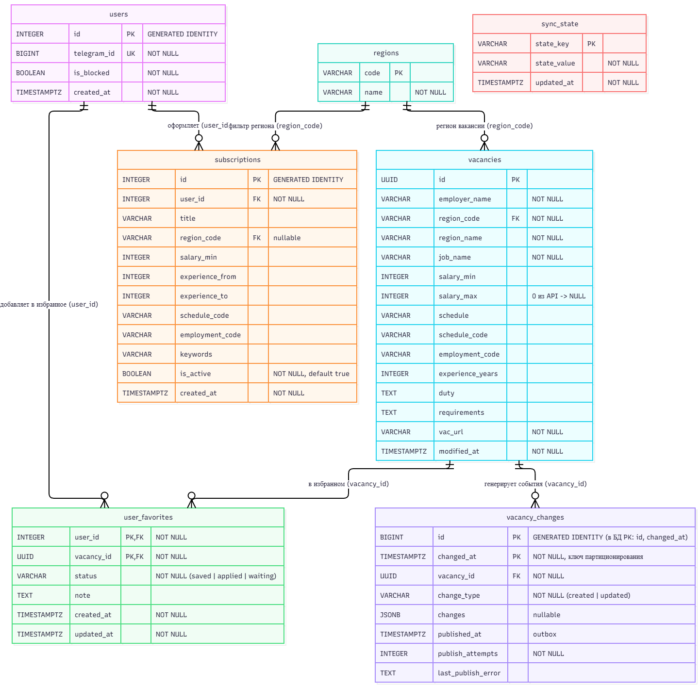

# JobFinder (`vacancy-bot`)

Курсовой проект по дисциплине **Конструирование программного обеспечения**.

Telegram-бот для мониторинга вакансий портала «Работа в России» (`trudvsem.ru`), позволяющий:
1. Настраивать персонализированные подписки на поиск новых вакансий по заданным критериям (название, регион, минимальная зарплата, опыт, график, тип занятости, ключевые слова).
2. Получать push-уведомления в Telegram о появлении новых подходящих вакансий со ссылкой на карточку.
3. Отслеживать изменения условий (например, зарплаты или описания) в вакансиях, добавленных в избранное, с перечнем изменённых полей.
4. Сохранять интересные вакансии в избранное с заметками и управлять активностью своих подписок.

---

## Участники проекта

| ФИО | Группа | Роль в проекте (модуль и порт) |
|-----|--------|--------------------------------|
| *Васильева Полина Васильевна* | *5130904/40101* | `db-service` (порт `8081`) — REST API к PostgreSQL, миграции Flyway, сравнение версий вакансий |
| *Владимирова Ангелина Андреевна* | *5130904/40101* | `bot-service` (порт `8080`) — Telegram webhook, обработка команд, FSM `/subscribe` |
| *Можегова Мария Владимировна* | *5130904/40101* | `worker-service` (порт `8082`) — опрос API `trudvsem.ru`, передача данных в `db-service`, публикация событий в RabbitMQ |
| *Маслов Алексей Александрович* | *5130904/40101* | `notifier-service` (порт `8083`) — чтение очереди событий, подбор подписчиков, отправка уведомлений в Telegram |

> **Общий модуль:** `common` (без сетевого порта) — общие DTO и константы (изменения вносятся только через Pull Request всеми участниками).

---

## 1. Определение проблемы

Соискателям сложно своевременно отслеживать появление новых вакансий и изменение условий по интересующим позициям на портале «Работа в России» (`trudvsem.ru`) из-за отсутствия персонализированных push-уведомлений и удобного инструмента сохранения вакансий. Пользователям приходится регулярно вручную повторять поисковые запросы на сайте, что отнимает время и повышает риск пропустить подходящие предложения.

---

## 2. Выработка требований

### 2.1 Пользовательские сценарии

1. **Подписка на поиск:** Когда на портале `trudvsem.ru` появляются новые вакансии по интересующим меня критериям (например, региону), я хочу настроить подписку в Telegram-боте и получать уведомления со ссылкой на вакансию, чтобы оперативно откликаться на свежие предложения без ручного мониторинга сайта.
2. **Отслеживание изменений условий:** Когда работодатель обновляет условия (например, зарплату или описание) в уже опубликованной вакансии, отмеченной избранной, я хочу получить в Telegram уведомление с перечнем изменённых полей, чтобы своевременно оценить актуальность предложения.
3. **Избранное и управление подписками:** Когда я нахожу интересную вакансию, я хочу сохранить её в избранное, чтобы следить за её изменениями, а также удалять свои подписки, чтобы поддерживать порядок в поиске работы.

### 2.2 Ограничения предметной области и внешнего источника

- **Закрытие вакансии отследить невозможно:** открытый API `trudvsem.ru` не возвращает статус закрытия, колонка `closed_at` и тип события `closed` в системе отсутствуют, а закрытые вакансии продолжают присутствовать в выдаче API (подтверждено проверкой на реальных примерах). Поддерживаются только события `created` и `updated`.
- **Периодичность обновления источника:** данные в открытом API портала обновляются примерно раз в сутки.
- **Глубина догоняющей загрузки:** потолок догоняющей загрузки при простое составляет 48 часов (изменения за более давний период не загружаются).
- **Скорость источника:** запрос к API занимает около 7–8 секунд (до 17) независимо от размера страницы, номера страницы и длины окна, поэтому время загрузки определяется числом запросов. Параллельные запросы портал обрабатывает лишь частично: четыре одновременных запроса выполняются за 11–14 секунд вместо 28 при последовательной отправке (замеры).

### 2.3 Оценка аудитории и нагрузки

- **Целевая аудитория:** ориентировочно 10 000 активных пользователей в сутки (~10 действий в боте на пользователя, 5 подписок и 20 избранных вакансий в среднем на пользователя).
- **Поток уведомлений:** в среднем 3 уведомления на пользователя в сутки (30 000 уведомлений в сутки).
- **Объём данных портала:** ~1,5 млн актуальных вакансий на портале, ~50 000 новых вакансий и ~100 000 обновлений вакансий в сутки.

### 2.4 Период хранения данных

- **Срок хранения:** 6 лет.
- Таблицы истории изменений (`vacancy_changes`) и журнала отправки уведомлений (`notification_log`) секционированы по годам (партиции `2026`, `2027`, `2028` и `default`; для обеспечения хранения в течение 6 лет новые годовые партиции добавляются заранее, до 2029 года и далее).

---

## 3. Разработка архитектуры и детальное проектирование

### 3.1 Характер нагрузки

Допущения

| Параметр | Значение |
| --- | --- |
| Активных пользователей в сутки | 10 тыс.  |
| Действий в боте на пользователя в сутки | ~10 |
| Подписок / избранных вакансий на пользователя | 5 / 20 |
| Уведомлений на пользователя в сутки | 3 (30 тыс. в сутки) |
| Вакансий на портале | ~1,5 млн |
| Новых вакансий в сутки | ~50 тыс |
| Обновлений вакансий в сутки | ~100 тыс. |
| Срок хранения | 6 лет |

Соотношение чтения и записи

| Источник | Чтение в сутки | Запись в сутки |
| --- | --- | --- |
| Пользователи через бота (10 тыс. x 10 действий) | 70 тыс. | 30 тыс. |
| Poller: загрузка текущего состояния для сравнения | 100 тыс. | — |
| Poller: обновление вакансий (100 тыс.) и история изменений (70 тыс.) | — | 170 тыс. |
| Notifier: вакансия и подбор получателей по 70 тыс. событий | ~170 тыс. | — |
| Notifier: журнал (вставка и смена статуса, 30 тыс. x 2) | — | 60 тыс. |
| Итого | ~340 тыс. | ~260 тыс. |

Для пользовательских запросов соотношение примерно 70:30 в пользу чтения.

Объёмы трафика

| Поток | Запросов в сутки | Объём в сутки | Средняя / пиковая |
| --- | --- | --- | --- |
| Telegram → бот (webhook) | 100 тыс. | ~100 МБ | 1,2 / ~12 RPS |
| Бот → Telegram (ответы) | 100 тыс. | ~100 МБ | то же |
| Notifier → Telegram | 30 тыс. | ~30 МБ | 0,35 в с / не более 25 в с (лимитер) |
| API «Работа России» → Poller | ~1 тыс. страниц | ~400 МБ (100 тыс. вакансий × ~4 КБ) | ~5 КБ/с |
| Poller → db-service (sync) | ~1 тыс. пакетов | ~400 МБ | внутренний |
| События Poller → RabbitMQ → Notifier | 70 тыс. | ~20 МБ | ~0,8 в с |

Внешний трафик составляет около 0,6–0,7 ГБ в сутки, примерно 20 ГБ в месяц.

Объёмы дисковой системы (за 6 лет)

| Данные | Строк | Размер строки с индексами | Итого |
| --- | --- | --- | --- |
| users | 50 тыс. | ~0,1 КБ | ~5 МБ |
| subscriptions | 250 тыс. | ~0,4 КБ | ~0,1 ГБ |
| user_favorites (с заметками) | 1 млн | ~0,25 КБ | ~0,25 ГБ |
| vacancies (актуальные) | ~1,5 млн | ~4,5 КБ (текст и GIN-индекс) | ~7 ГБ |
| vacancy_changes | ~153 млн (70 тыс. × 365 × 6) | ~0,2 КБ | ~30 ГБ |
| notification_log | ~66 млн (30 тыс. × 365 × 6) | ~0,11 КБ | ~7 ГБ |
| Итого данных |  |  | ~45 ГБ |

### 3.2 Модель C4

#### Поток данных

```text
Telegram -> bot-service -> db-service -> PostgreSQL
trudvsem.ru -> worker-service -> db-service (сравнение, история) -> RabbitMQ -> notifier-service -> Telegram
```

#### Уровень 1 — контекст системы (C4-1)


#### Уровень 2 — контейнеры (C4-2)


### 3.3 Контракты и нефункциональные требования по времени отклика

#### Системные команды Telegram

| Команда | Описание и назначение | Ответ системы |
|---------|-----------------------|---------------|
| `/start` | Регистрация пользователя в системе и приветствие | Приветственное сообщение с описанием возможностей бота и главным меню |
| `/subscribe` | Инициация пошагового мастера создания подписки на вакансии | Переход к FSM-сценарию создания подписки (запрос названия вакансии) |
| `/subscriptions` | Просмотр и управление текущими активными подписками | Список подписок с кнопками управления для каждой |
| `/favorites` | Просмотр списка избранных вакансий | Карточки сохранённых вакансий |
| `/help` | Вывод справки по работе с ботом и формату поиска | Инструкция по настройке подписок и контакты поддержки |

#### Интерактивный FSM-сценарий создания подписки (`/subscribe`)

Бот последовательно задаёт 7 вопросов: **название вакансии** (`SEARCH_TITLE`), **регион** (`SEARCH_REGION`), **минимальная зарплата** (`SEARCH_SALARY`), **опыт работы** (`SEARCH_EXPERIENCE`), **график работы** (`SEARCH_SCHEDULE`), **тип занятости** (`SEARCH_EMPLOYMENT`), **ключевые слова** (`SEARCH_KEYWORDS`), после чего переходит к подтверждению (`CONFIRM_SUBSCRIPTION`).
- Под каждым вопросом доступна кнопка «Пропустить» (`sub_skip`), сохраняющая параметр как `NULL`.
- Если пропущены все параметры, бот выводит предупреждение «Укажите хотя бы один параметр поиска» и возвращает пользователя к первому шагу.
- После ответа у предыдущего сообщения удаляются инлайн-кнопки (`editMessageReplyMarkup`) и вызывается `AnswerCallbackQuery`.

#### Контракты Callback-запросов (инлайн-кнопки)

| Префикс / Pattern | Назначение кнопки | Действие бэкенда | Обратная связь (Telegram) |
|-------------------|-------------------|------------------|---------------------------|
| `fav_add_{vac_id}` | В избранное | Идемпотентное добавление записи в `user_favorites` | `AnswerCallbackQuery`: «Добавлено в избранное» |
| `fav_del_{vac_id}` | Удалить из избранного | Удаление записи из `user_favorites` | Удаление сообщения или обновление карточки |
| `sub_del_{sub_id}` | Удалить подписку | Физическое удаление подписки через `DELETE` | `AnswerCallbackQuery`: «Подписка удалена» |
| `sub_skip` | Пропустить вопрос | Сохранение `NULL` и переход к следующему шагу FSM | `AnswerCallbackQuery`: «Вопрос пропущен» |
| `sub_reg_{region_code}` | Быстрый выбор региона | Сохранение кода региона и переход в `SEARCH_SALARY` | `AnswerCallbackQuery`; следующий вопрос мастера |
| `sub_sal_{amount}` | Выбор мин. зарплаты | Сохранение `salary_min` и переход в `SEARCH_EXPERIENCE` | `AnswerCallbackQuery`; следующий вопрос мастера |
| `sub_exp_{code}` | Выбор опыта работы | Сохранение `experience` (`none`, `1_3`, `3_6`, `6_plus`) | `AnswerCallbackQuery`; следующий вопрос мастера |
| `sub_sch_{code}` | Выбор графика работы | Сохранение `schedule` (`rotation`, `flex`, `shift`, `irregular`, `part`, `full`) | `AnswerCallbackQuery`; следующий вопрос мастера |
| `sub_emp_{code}` | Выбор типа занятости | Сохранение `employment` (`rotation`, `remote`, `temp`, `intern`) | `AnswerCallbackQuery`; следующий вопрос мастера |
| `sub_confirm` | Создать подписку | Запись в `subscriptions`, сброс контекста и FSM | `AnswerCallbackQuery`: «Подписка создана» |
| `sub_cancel` | Отмена создания подписки | Очистка контекста сессии, сброс FSM | `AnswerCallbackQuery`: «Создание подписки отменено» |

#### db-service: контракт REST API

##### Общие правила

- Все пути начинаются с `/api`. Тела запросов и ответов: JSON, DTO из модуля `common`.
- Ошибки приходят как `{"error": "текст"}`: `400` неверные данные, `404` не найдено, `409` нарушено ограничение БД.
- `telegramId` в путях — Telegram ID пользователя (`Long`), а не внутренний `users.id`.
- Идентификатор вакансии (`vacancyId`) — UUID строкой (`String`).
- Время передаётся строкой ISO-8601 с часовым поясом (в Java — `Instant`), например `2026-11-08T12:30:00Z`.
- `null` в теле запроса означает «не менять» (там, где так сказано) или «не важно» (для критериев подписки).

##### Для bot-service

###### Пользователи

| Метод | Путь | Тело / Параметры | Ответ и поведение |
|---|---|---|---|
| `POST` | `/api/users/{telegramId}` | — | `204 No Content`. Идемпотентно создаёт пользователя или находит существующего (`getOrCreate`, команда `/start`). |

###### Подписки

| Метод | Путь | Тело / Параметры | Ответ и поведение |
|---|---|---|---|
| `POST` | `/api/subscriptions` | Тело: `SubscriptionDto` (`telegramUserId` обязателен) | `201 Created`, `SubscriptionDto`. Подписка всегда создаётся активной. |
| `GET` | `/api/users/{telegramId}/subscriptions` | Query: `?onlyActive=true` (по умолчанию `false`) | `200`, `List<SubscriptionDto>`. Если пользователя нет — `[]`. |
| `PUT` | `/api/users/{telegramId}/subscriptions/{id}` | Тело: `SubscriptionDto` | `200`, `SubscriptionDto`. Заменяет критерии подписки, `active` не меняется. |
| `PATCH` | `/api/users/{telegramId}/subscriptions/{id}/active` | Query: `?value=true\|false` | `200`, `SubscriptionDto`. Пауза (`false`) или возобновление (`true`). |
| `DELETE` | `/api/users/{telegramId}/subscriptions/{id}` | — | `204 No Content`. Физически удаляет строку из БД. |

###### Избранное

| Метод | Путь | Тело / Параметры | Ответ и поведение |
|---|---|---|---|
| `GET` | `/api/users/{telegramId}/favorites` | — | `200`, `List<FavoriteDto>` (новые сверху, без данных вакансий). |
| `GET` | `/api/users/{telegramId}/favorites/{vacancyId}` | — | `200`, `FavoriteDto`. `404`, если записи нет в избранном. |
| `PUT` | `/api/users/{telegramId}/favorites/{vacancyId}` | Тело: `FavoriteDto` (необязательно) | `200`, `FavoriteDto`. Повтор не падает; новая запись получает `SAVED`. Если вакансии нет в БД — `404`. |
| `PATCH` | `/api/users/{telegramId}/favorites/{vacancyId}` | Тело: `FavoriteDto` (`status` и/или `note`) | `200`, `FavoriteDto`. Обновляет статус и/или заметку. |
| `DELETE` | `/api/users/{telegramId}/favorites/{vacancyId}` | — | `204 No Content`. Удаляет вакансию из избранного. |

###### Вакансии и справочники

| Метод | Путь | Тело / Параметры | Ответ и поведение |
|---|---|---|---|
| `GET` | `/api/vacancies` | Query: `?ids=uuid1,uuid2,...` (до 100 шт.) | `200`, `List<VacancyDto>`. Карточки вакансий пачкой; несуществующие `id` пропускаются. |
| `GET` | `/api/regions` | — | `200`, `List<RegionDto>`. Все регионы по алфавиту. |

##### Для worker-service

###### Синхронизация вакансий

| Метод | Путь | Тело / Параметры | Ответ и поведение |
|---|---|---|---|
| `POST` | `/api/vacancies/sync` | Тело: `List<VacancyUpsertDto>` (до 100 штук) | `200`, `List<VacancyChangeDto>` (только по новым и изменённым вакансиям). Сравнивает состояние и пишет историю изменений в БД. |
| `GET` | `/api/vacancies/last-modified` | — | `200`, `Instant` (ISO-8601) или пустой ответ (`null`), если вакансий нет. Запасной вариант курсора для первого запуска. |

###### Курсор синхронизации

| Метод | Путь | Тело / Параметры | Ответ и поведение |
|---|---|---|---|
| `GET` | `/api/sync-state/{key}` | Path: `key` (например, `vacancies.cursor`) | `200`, `SyncStateDto`. `404`, если ключа ещё нет. |
| `PUT` | `/api/sync-state/{key}` | Тело: `SyncStateValueDto` (`{"value": "..."}`) | `200`, `SyncStateDto`. Идемпотентно создаёт или обновляет значение; пустое `value` — `400`. |

###### Публикация событий / Outbox

| Метод | Путь | Тело / Параметры | Ответ и поведение |
|---|---|---|---|
| `GET` | `/api/changes/unpublished` | Query: `?limit=200` (по умолчанию 200, макс. 1000) | `200`, `List<VacancyChangeDto>` по возрастанию `changeId`. События с 5+ неудачными попытками не возвращаются. |
| `POST` | `/api/changes/published` | Тело: `List<ChangeKeyDto>` (до 1000 ключей) | `200`, `{"marked": n}` — количество помеченных записей. Повторные и неизвестные ключи не дают ошибку. |
| `POST` | `/api/changes/publish-failed` | Тело: `PublishFailedDto` | `200`, `{"updated": n}` (`0`, если событие не найдено). Увеличивает счётчик неудач на 1 и сохраняет `error` (до 500 символов). |

##### Для notifier-service

| Таблица / Колонка | Тип и ключи | Назначение и правила работы |
|---|---|---|
| `users.is_blocked` | `boolean NOT NULL DEFAULT false` | Ставит `notifier-service` при блокировке бота; сбрасывает `db-service` при новом обращении пользователя к боту. |
| `notification_log` | Партиционирована по `changed_at`, PK: `(change_id, user_id, changed_at)` | Журнал отправок (`pending`, `sent`, `failed`, `blocked`). Вставка через `ON CONFLICT DO NOTHING`, обновление статусов по полному PK. |

#### Контракт события в RabbitMQ

```json
{
  "change_id": 12345,
  "changed_at": "2026-11-24T10:15:00.123456Z",
  "vacancy_id": "3f2b8c1e-6a4d-4e0a-9c55-0d1f2a3b4c5d",
  "type": "updated",
  "diff": {
    "salary_min": [50000, 70000]
  }
}
```

- `type` принимает значения `created` или `updated`; у `created` поле `diff` отсутствует.
- `diff`: ключи — имена колонок таблицы `vacancies`, значения — пары `[было, стало]`.
- `changed_at` обязателен (ISO-8601 с часовым поясом);
- `vacancy_id` — идентификатор вакансии (UUID) из API портала.

#### Нефункциональные требования по времени отклика

| Операция / Параметр | Целевое значение |
|---------------------|------------------|
| Время ответа API портала на один запрос (замеры) | 7–8 с, до 17 с; не зависит от размера страницы |
| Запрос к внешнему API `trudvsem.ru` (таймаут подключения / чтения) | 5 с / 60 с (до 3 повторов с паузами 1, 2, 4 с; не более 3 одновременных запросов) |
| Доставка уведомления с момента появления данных в API портала | ≤ 1,5 часа (опрос каждые 15 мин + около 1 часа на выгрузку суточного пакета: ~1 тыс. запросов по 7–8 с при 3 параллельных запросах) |
| Сквозная задержка от изменения вакансии на сайте до уведомления | до 24 часов (определяется периодичностью обновления выгрузки на стороне портала) |

### 3.4 Схема базы данных



**Почему схема выдерживает нефункциональные требования:**
- **Годовое секционирование (партиционирование):** объёмные таблицы `vacancy_changes` и `notification_log` разбиты по годам (`2026`, `2027`, `2028`, `default`), что ограничивает размер B-tree индексов и ускоряет поиск дубликатов на горизонте хранения 6 лет.
- **Фильтрация по числовому коду региона:** сравнение по 13-значному коду избавляет от дорогих строковых операций и расхождений в написании («г. Москва» / «Город Москва»).
- **Точечный подбор подписчиков:** выборка выполняется в момент обработки события только по активным незаблокированным пользователям.

### 3.5 Масштабирование при росте нагрузки в 10 раз

1. **Независимость `worker-service` от числа пользователей.** При росте аудитории в 10 раз (до 100 000 DAU) нагрузка на `worker-service` и внешний API `trudvsem.ru` не увеличивается, так как определяется только объёмом изменений на самом портале. Worker остаётся в 1 экземпляре (единый курсор в `sync_state` без распределённой блокировки), используя пул из 3 потоков для параллельной загрузки страниц окна и перекрытие окон (`overlap` 2 часа).
2. **Надёжность очереди (`At-least-once` + идемпотентность).** События фиксируются в outbox таблицы `vacancy_changes` и помечаются опубликованными только после подтверждения от RabbitMQ. Повторная доставка при сбоях отсекается уникальным ключом `(change_id, user_id, changed_at)` в `notification_log`.
3. **Горизонтальное масштабирование пользовательского контура.** Запуск ×3 реплик `bot-service` и `notifier-service` за балансировщиком нагрузки с TLS вместо `ngrok`.
4. **Масштабирование уровня БД.** Внедрение пулера соединений PgBouncer перед PostgreSQL, выделение реплик чтения (Read Replicas) для подбора подписчиков и заблаговременная нарезка годовых партиций.

---

## 4. Кодирование и отладка

### 4.1 Организация кода

Проект построен по микросервисной архитектуре на **Java 21** и **Maven** с выделением общего модуля `common` для контрактов DTO и констант:

| Модуль | Назначение |
|--------|------------|
| `common` | Общие DTO и константы (изменения через Pull Request) |
| `bot-service` | Обработка Telegram webhook, команды, конечный автомат (FSM) `/subscribe` |
| `db-service` | Единый владелец схемы БД, REST API, миграции Flyway, сравнение версий вакансий |
| `worker-service` | Планировщик опроса API `trudvsem.ru`, загрузка окнами, публикация событий из outbox |
| `notifier-service` | Потребитель очереди RabbitMQ, подбор подписчиков, форматирование и отправка сообщений |

### 4.2 Процесс разработки

Разработка велась в общем Git-репозитории с разделением зон ответственности по микросервисам и согласованием изменений в общих контрактах (`common`) через Pull Request.

---

## 5. Модульное (unit) тестирование

### 5.1 Инструменты и принципы

Модульные тесты во всех микросервисах проекта написаны на базе **JUnit 5**, **Mockito** и **AssertJ** (из состава `spring-boot-starter-test`). Для проверки HTTP-взаимодействия между сервисами и внешними API используется `MockRestServiceServer` из Spring Test.

При разработке тестов соблюдаются единые инженерные принципы:

- **Полная изоляция от внешней инфраструктуры.** При выполнении unit-тестов не поднимаются реальные база данных, брокер сообщений и внешние веб-сервисы. Сетевые вызовы подменяются моками или эмуляторами в памяти.
- **Проверка негативных и граничных сценариев.** Помимо штатного выполнения («happy path»), проверяются таймауты, ошибки HTTP (повторяемые 5xx и неповторяемые 4xx), некорректный или пустой пользовательский ввод, сбои брокера сообщений, дублирование запросов и сбои посреди выполнения операции.
- **Контроль ключевых инвариантов и идемпотентности.** Тесты гарантируют соблюдение критичных правил предметной области: безопасность повторной обработки данных, корректность переходов состояний, отсутствие потери событий и отсечение дубликатов.
- **Валидация контрактов и конфигурации.** Проверяются сериализация/десериализация DTO (в том числе из общего модуля `common`), соответствие форматов JSON-сообщений и корректность связывания параметров из конфигурационных файлов `application.yml`.

### 5.2 Запуск тестов

Тесты запускаются стандартными средствами Maven как для всего многомодульного проекта, так и изолированно для любого отдельного сервиса (с автоматической сборкой зависимости `common`):

```powershell
# запуск всех unit-тестов во всех модулях проекта
mvn test

# запуск тестов конкретного модуля 
mvn -pl <имя-модуля> -am test

# запуск одного конкретного тестового класса
mvn -pl <имя-модуля> -am test -Dtest=<ИмяТестовогоКласса> -Dsurefire.failIfNoSpecifiedTests=false
```

---

## 6. Интеграционное тестирование

Для проверки пользовательской истории «настроить подписку и получить уведомление о подходящей вакансии» реализован сквозной сценарий в `integration-tests/run.ps1`. Он запускает все четыре приложения (`bot-service`, `db-service`, `worker-service`, `notifier-service`) вместе с PostgreSQL, Redis и RabbitMQ через отдельный Docker Compose стек.

Внешние Telegram API и API `trudvsem.ru` заменены локальным тестовым сервером. Поэтому прогон не обращается к реальным внешним системам и не отправляет сообщения пользователям.

Сценарий выполняет следующие шаги:
1. Отправляет webhook `/start` и `/subscribe` в `bot-service`.
2. Проходит мастер создания подписки: вводит название вакансии, пропускает необязательные критерии и подтверждает подписку.
3. Проверяет через API `db-service`, что подписка сохранена и активна.
4. Включает тестовую вакансию. `worker-service` получает её из тестового API и передаёт в `db-service`.
5. Проверяет доставку события через outbox и RabbitMQ в `notifier-service`.
6. Проверяет, что `notifier-service` отправил подходящее уведомление в тестовый Telegram endpoint.

Запуск в корне проекта:

```
.\integration-tests\run.ps1
```

При успехе сценарий выводит `PASS`. Тестовый Compose стек и его отдельный том удаляются после завершения. Сценарий запускался на проекте и завершился успешно.

---

## 7. Сборка и запуск

### 7.1 Требования к окружению

Для локальной сборки и запуска потребуются:
- **Docker Desktop** (с поддержкой Docker Compose)
- **JDK 21** и **Maven**
- Токен Telegram-бота (`TELEGRAM_BOT_TOKEN`)
- Утилита **ngrok** (для проброса публичного HTTPS-адреса в dev-окружении)

### 7.2 Конфигурация

Параметры подключения к БД и брокеру, токены и настройки окружения задаются в файле `.env` на основе шаблона `.env.example` (без секретных значений):
- `POSTGRES_*` — реквизиты подключения к PostgreSQL
- `RABBITMQ_*` — реквизиты подключения к RabbitMQ
- `TELEGRAM_BOT_TOKEN` — токен Telegram-бота
- `BOT_WEBHOOK_URL` — публичный HTTPS-адрес для Telegram Webhook (обновляется при перезапуске `ngrok`)
- `BOT_WEBHOOK_SECRET` — секретный токен проверки webhook
- `BOT_HOST_PORT` — внешний порт бота (по умолчанию `8080`, при конфликте с локальными службами переопределяется в `.env`)

### 7.3 Запуск через Docker Compose

Система разворачивается единым файлом `docker-compose.yml`, поднимающим контейнеры `postgres`, `rabbitmq`, `redis`, `db-service`, `worker-service`, `notifier-service` и `bot-service` (по 1 экземпляру каждого сервиса).

- Взаимодействие между сервисами идёт по внутренним DNS-именам Docker-сети (`db-service:8081`, `postgres:5432`).
- Для `postgres`, `redis` и `db-service` настроены проверки состояния (`healthcheck`), остальные сервисы стартуют строго после их готовности (`depends_on: condition: service_healthy`).
- Для `worker-service`, `bot-service` и `notifier-service` явно заданы DNS-серверы `[8.8.8.8, 1.1.1.1]` для стабильного разрешения внешних доменов `opendata.trudvsem.ru` и `api.telegram.org`.

```powershell
mvn -pl common -am install -DskipTests
ngrok http 8080                           # https-адрес + /webhook -> BOT_WEBHOOK_URL в .env
docker compose up -d --build
docker compose ps                         # все сервисы Up
```
